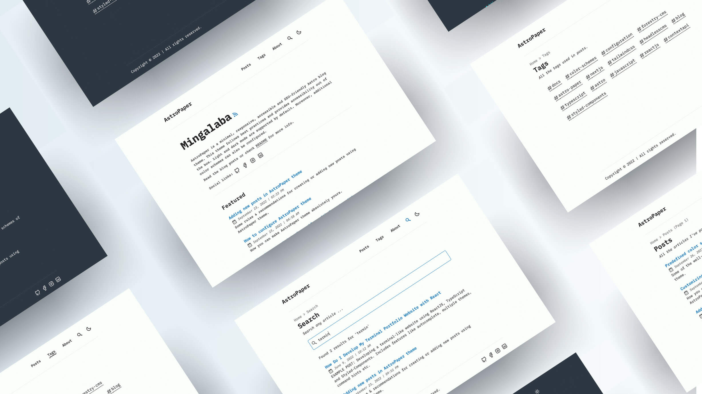

# Amal PK Notes


[](https://www.figma.com/community/file/1356898632249991861)


[](https://conventionalcommits.org)
[](http://commitizen.github.io/cz-cli/)

Amal PK Notes is a security-focused blog covering application security,
penetration testing, Android security, vulnerability research, and Hack The Box
writeups. It is built with Astro and based on the AstroPaper theme.

Read the [blog posts](https://notes.amalpk.in/posts/) or visit the
[portfolio](https://amalpk.in/).

## 🔥 Features

- [x] type-safe markdown
- [x] super fast performance
- [x] accessible (Keyboard/VoiceOver)
- [x] responsive (mobile ~ desktops)
- [x] SEO-friendly
- [x] light & dark mode
- [x] static search ([Pagefind](https://pagefind.app/))
- [x] draft posts & pagination
- [x] sitemap & rss feed
- [x] MDX support
- [x] table of contents beside posts
- [x] followed best practices
- [x] highly customizable
- [x] dynamic OG image generation for blog posts
- [x] i18n ready

_Note: I've tested screen-reader accessibility of AstroPaper using **VoiceOver** on Mac and **TalkBack** on Android. I couldn't test all other screen-readers out there. However, accessibility enhancements in AstroPaper should be working fine on others as well._

## 🚀 Project Structure

Inside of AstroPaper, you'll see the following folders and files:

```bash
/
├── public/
│   ├── pagefind/          # auto-generated on build
│   ├── images/
│   │   └── posts/         # images referenced by blog posts
│   ├── favicon.svg
│   └── default-og.jpg
├── src/
│   ├── assets/
│   │   ├── icons/
│   │   └── images/
│   ├── components/
│   ├── content/
│   │   └── posts/
│   │       └── some-blog-posts.md
│   ├── i18n/
│   ├── layouts/
│   ├── pages/
│   ├── scripts/
│   ├── styles/
│   ├── types/
│   ├── utils/
│   ├── config.ts
│   └── content.config.ts
├── astro-paper.config.ts  # user-defined configurations
└── astro.config.ts
```

All blog posts are stored in the `src/content/posts/` directory. You can organise posts into subdirectories — the subdirectory name becomes part of the post URL.

## 📖 Project documentation

- [SEO research report](SEO-RESEARCH-REPORT.md)
- [SEO implementation tracker](SEO-IMPLEMENTATION-TRACKER.md)

## 💻 Tech Stack

**Main Framework** - [Astro](https://astro.build/)  
**Type Checking** - [TypeScript](https://www.typescriptlang.org/)  
**Styling** - [TailwindCSS](https://tailwindcss.com/)  
**UI/UX** - [Figma Design File](https://www.figma.com/community/file/1356898632249991861)  
**Static Search** - [Pagefind](https://pagefind.app/)  
**Icons** - [Tablers](https://tabler-icons.io/)  
**Code Formatting** - [Prettier](https://prettier.io/)  
**Deployment** - [Cloudflare Pages](https://pages.cloudflare.com/)  
**Linting** - [ESLint](https://eslint.org)  
**Dynamic OG images** - [Satori](https://github.com/vercel/satori) + [Sharp](https://sharp.pixelplumbing.com/) + [Astro Fonts](https://docs.astro.build/en/guides/fonts/)

## 👨🏻‍💻 Running Locally

```bash
# install dependencies
pnpm install

# start the project
pnpm dev
```

## Google Site Verification (optional)

You can add your [Google Site Verification HTML tag](https://support.google.com/webmasters/answer/9008080#meta_tag_verification&zippy=%2Chtml-tag) by setting `site.googleVerification` in `astro-paper.config.ts`:

```ts file="astro-paper.config.ts"
export default defineAstroPaperConfig({
  site: {
    // ...
    googleVerification: "your-google-site-verification-value",
  },
  // ...
});
```

> See [this discussion](https://github.com/satnaing/astro-paper/discussions/334#discussioncomment-10139247) for adding AstroPaper to the Google Search Console.

## 🧞 Commands

All commands are run from the root of the project, from a terminal:

| Command          | Action                                                                                                                           |
| :--------------- | :------------------------------------------------------------------------------------------------------------------------------- |
| `pnpm install`   | Installs dependencies                                                                                                            |
| `pnpm dev`       | Starts local dev server at `localhost:4321`                                                                                      |
| `pnpm build`     | Type-checks, builds the site, runs Pagefind indexing, and copies the index to `public/pagefind/`                                 |
| `pnpm preview`   | Preview your build locally, before deploying                                                                                     |
| `pnpm sync`      | Generates TypeScript types for all Astro modules. [Learn more](https://docs.astro.build/en/reference/cli-reference/#astro-sync). |
| `pnpm astro ...` | Run CLI commands like `astro add`, `astro check`                                                                                 |

## ✨ Feedback & Suggestions

For feedback or security concerns, contact [hello@amalpk.in](mailto:hello@amalpk.in).

## 📜 License

Licensed under the MIT License, Copyright © 2026

---

Based on [AstroPaper](https://github.com/satnaing/astro-paper), with the original MIT
license retained.
